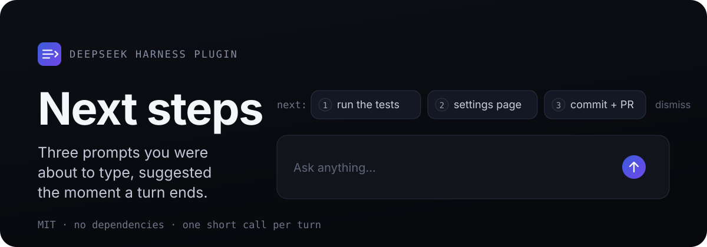
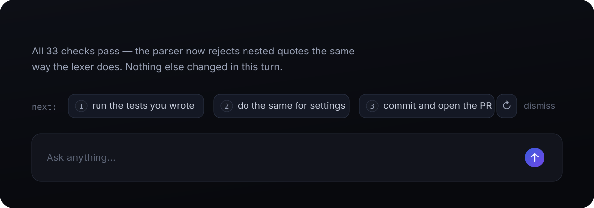
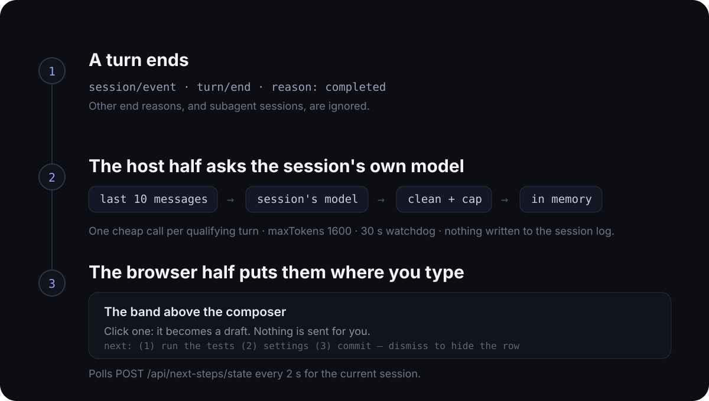

<p align="center">
  
</p>

<p align="center">
  <b>English</b> · <a href="README.zh-CN.md">简体中文</a>
</p>

## Project overview

Next steps is a plugin for DeepSeek Harness (DSH). When a turn finishes, it reads the conversation, asks the session's own model what you would plausibly send next, and offers up to three prompts you can accept with one click.

It costs one short model call per qualifying turn. It never sends anything on your behalf.

**Who it's for.** DSH users on the web client — the desktop app or `dsh web` — who have just read an answer and still face an empty composer; and anyone who works in `/skill` prompts, since a suggestion can be a real invocation to edit rather than one to write from scratch.

**The problem.** Every finished turn restarts from a blank composer with no natural continuation point; standing up a second provider just for suggestions is not worth another API key or bill; and generic suggestions are worse than typing, so a suggestion has to have actually read the conversation.

**Main features.**

- **Chips above the composer.** Three numbered prompts, one click away. Hover or keyboard-focus a chip to read its full prompt in a tooltip; clicking one writes it into the composer as a draft — edit it, then press Enter yourself. Regenerate the row in place for a fresh set, or dismiss it when it is not what you wanted.
- **Suggestions that know the session.** The model sees the last ten human and model messages, and — when enabled — the session's skill catalog, so a suggestion can be a real `/skill` prompt rather than generic advice. Prompts come back in the language you were already using.
- **No provider to set up.** Suggestions run on whatever model route the session already uses, so there is no second API key and no extra bill to reconcile.

## What it looks like

<p align="center">
  
</p>

The moment a turn ends: three numbered prompts, right where you type. Press one and it lands in the input box as a draft; nothing is sent until you press Enter yourself. The row also carries a regenerate control, so a set that missed the mark can be replaced without waiting for another turn.

## Install

Requires DSH with the web client — the desktop app, or `dsh web` — and `pnpm` on your `PATH`.

**Desktop app.** Clone the repository, then install the bundle from **Settings → Plugins** and point it at the cloned folder. The installer accepts an absolute local path, an npm package (for example `@zongcn/dsh-next-steps`), a git URL or a tarball.

**`dsh web`.** Install the published package:

```sh
dsh plugin --profile web add @zongcn/dsh-next-steps
```

Or install from a clone, which links the checkout:

```sh
git clone https://github.com/WURONZON/dsh-next-steps.git
dsh plugin --profile web add "$PWD/dsh-next-steps"
```

`dsh plugin` runs pnpm inside the profile directory; because this package declares `dsh.bundle.patch`, the manager also records it in that profile's `dsh.profile.bundles`. The npm install pins a published version; a clone installs as a local link, so pulling or editing the checkout is enough before the next reload. The desktop profile belongs to the app and refuses the standalone CLI, which is why it takes the settings path.

**Reload.** A newly added bundle is applied by the profile's HMR; replacing an installed copy needs a restart. Suggestions regenerate on a session's next completed turn.

**Uninstall.** Remove the bundle in **Settings → Plugins**, or run `dsh plugin --profile web remove @zongcn/dsh-next-steps`, then restart.

**Re-installing a renamed or re-linked package.** Toggling the plugin off and on in **Settings → Plugins** only flips its entry in `dsh.profile.bundles`; it does not re-run pnpm, so the dependency keeps the key it was installed under. After renaming the package, or after pointing the desktop app at a different checkout, remove the plugin and install it again — the installer keys the dependency to the target's `package.json` name, and a `link:` dependency keeps the name it had at install time. A stale key fails the next boot with `<package>: import failed (see console for the import error)`, and the browser half then reports `client-modules: duplicate factory registration`.

<details>
<summary>Installing by hand</summary>

A profile is a `package.json` under `$DSH_HOME/profiles/<name>`, and a bundle loads only when it is both a dependency and listed in `dsh.profile.bundles`.

```json
{
  "dsh": { "profile": { "bundles": ["…", "@zongcn/dsh-next-steps"] } },
  "dependencies": { "@zongcn/dsh-next-steps": "link:/absolute/path/to/dsh-next-steps" }
}
```

Add both fields, run `pnpm install` in that directory, restart.

</details>

## Configure it

Options live in `cordis.patch.yml`, under the bundle row's `config`:

```yaml
- insert:
    - id: dsh-next-steps
      name: '@zongcn/dsh-next-steps'
      config:
        maxSuggestions: 3
        minAnswerChars: 80
```

| Option | Default | What it does |
| --- | --- | --- |
| `enabled` | `true` | Turn suggestion generation off entirely. |
| `maxSuggestions` | `3` | Upper bound on suggestions per turn. |
| `minAnswerChars` | `80` | Skip turns whose answer is shorter than this (measured on the last assistant message, after cleaning, capped at 1,800 characters). |
| `suggestSkills` | `true` | Tell the suggester which skills the session has, so a suggestion can be a `/skill arguments` prompt. |
| `maxInputChars` | `12000` | Skip a turn whose transcript exceeds this many characters. |
| `timeoutMs` | `30000` | Cancel one suggestion call after this long. |
| `maxOutputTokens` | `1600` | Output budget of the suggestion call. A reply that hits the budget still keeps every suggestion that closed before the cut. |

Values are shallow-merged over the defaults and are not type-checked, so write numbers as numbers and booleans as booleans.

## How it works

<p align="center">
  
</p>

Two halves ship as one bundle:

- **Host half** (`index.js`). Listens for a `turn/end` event with a `completed` reason, builds a digest of the last ten human and model messages, and calls the route recorded for the session — falling back to the newest logged request header, then the process default. The reply is parsed as JSON, cleaned, and kept in memory, keyed by session.
- **Browser half** (`client.js`). Registers the band above the composer, polls `POST /api/next-steps/state` every 2 s for the current session, and renders with the host's theme tokens and locale service.

Aborted, blocked, errored and interrupted turns are ignored, as are subagent sessions. The plugin appends nothing to the session log: suggestions are a derived, in-memory cache that disappears when the plugin unloads, and a hot reload starts empty.

## Safety

Model output is treated as untrusted. Before anything reaches the screen or the prompt box, terminal escape sequences, control, format, private-use and unassigned characters, variation selectors and Unicode tag characters are stripped, whitespace is folded, combining-mark runs are capped, and every label and prompt is length-limited by code point. A suggestion is sanitised text, never markup.

The plugin serves only the two local state routes it needs, and it never submits a prompt.

## Limits

- Every qualifying turn costs one model call, and so does each press of Regenerate. Raise `minAnswerChars` or `maxInputChars` to spend fewer.
- One conversation at a time: suggestions live in the band, so there is no overview of other sessions.
- `/skill` suggestions are not checked against the session's command catalog, so a suggested command that no longer exists has to be edited before it is sent.
- Suggestions are per session and per process. They are not shared between windows or restored after a restart.

## Development

```sh
npm test                      # 33 host checks + 13 dock checks, no dependencies, no browser
node scripts/selftest.mjs     # host half only
node scripts/verify-dock.mjs  # browser half: the composer band, driven by a React stub
node scripts/verify-ui.mjs    # optional Playwright run against a live GUI (see the script header)
```

**Releasing.** The full release checklist — version bump, CI, npm publish, GitHub Release, and clean-profile verification — lives in [English](RELEASING.md) and [简体中文](RELEASING.zh-CN.md).

The source is small enough to read in one sitting:

```text
index.js            host half: turn/end listener, model call, parsing, state routes
client.js           browser half: composer band, i18n, styles
cordis.patch.yml    bundle row and its default config
locale/             English and Chinese plugin metadata
assets/readme/      the SVG sources for the images above
scripts/            selftest.mjs, verify-dock.mjs, verify-ui.mjs
```

## Credits

A port of `next-steps` from the [Claude plugins community](https://github.com/anthropics/claude-plugins-community/tree/main/next-steps) (MIT), rebuilt on DSH services as a band above the composer.

## License

[MIT](LICENSE)