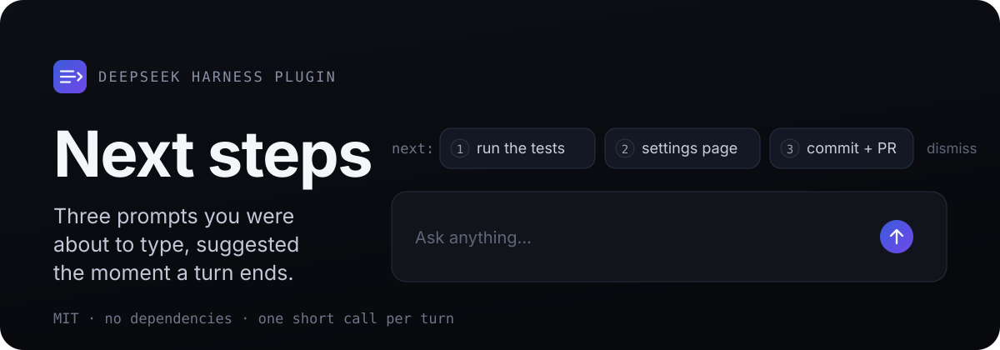
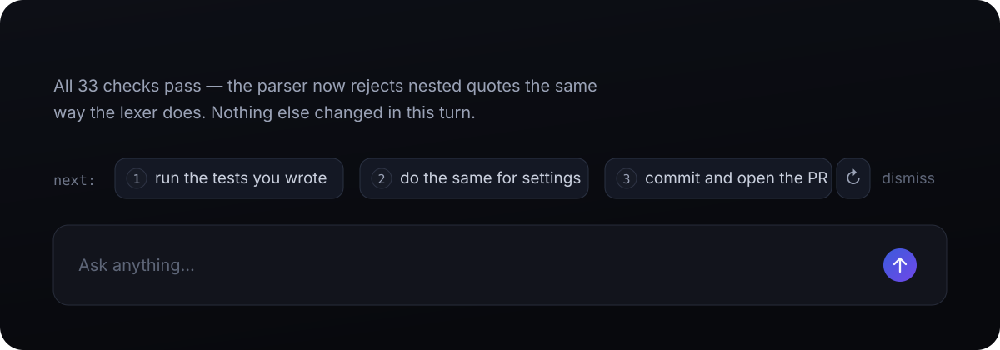
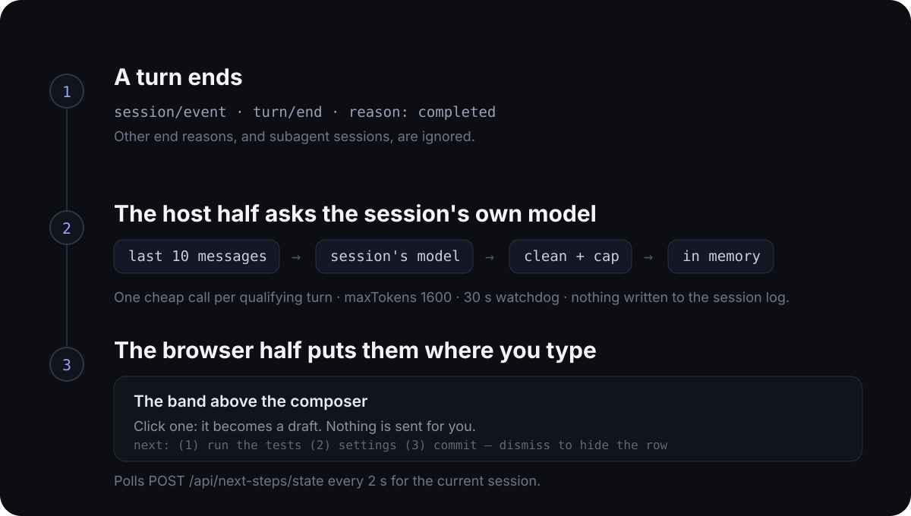

<p align="center">
  
</p>

<p align="center">
  <a href="README.md">English</a> · <b>简体中文</b>
</p>

## 项目介绍

Next steps 是 DeepSeek Harness（DSH）的一个插件。每轮回答结束，它会读一遍最近的对话，用这个会话自己的模型猜你接下来最可能发什么，然后把最多三条提示摆到你面前，点一下就进输入框。

每个符合条件的轮次只花一次很短的模型调用，并且从不替你发送任何内容。

**面向谁。** 装了带 Web 客户端（桌面应用或 `dsh web`）的 DSH 用户：回答看完了、输入框还空着，缺一个自然的下一步；也适合习惯用 `/skill` 的人——一条建议可以直接是改改就能发的技能调用。

**解决什么问题。** 每轮结束都要从零想「接下来问什么」，中间少一个自然的续接点；为了建议再配一个 provider 不划算，第二把 API key 和额外账单都不值得；泛泛的建议不如自己打字，所以建议必须真的读过这段对话。

**主要功能。**

- **输入框上方的建议 chips。** 三条带编号的提示；悬停或键盘聚焦会显示完整提示，点一下就写进输入框变成草稿——改完自己按回车；想换一批可以原地重新生成，不需要时点 dismiss 收起。
- **懂这段对话的建议。** 模型看到最近十条人和模型的消息，以及（默认开启的）本会话技能清单，所以建议可以是一个真正的 `/skill` 提示，而不是泛泛而谈；建议会沿用你刚才使用的语言。
- **不用再配一个 provider。** 建议跑在会话本来就在用的模型路由上，不需要第二把 API key，也不会多出一份账单。

## 实际效果

<p align="center">
  
</p>

一轮结束的那一刻：三条带编号的提示，就摆在你正要打字的地方。点一条，它落进输入框变成草稿；你自己按回车之前，什么都不会发送。横条上还有「重新生成」，不满意时不用等下一轮，原地换一批。

## 安装

需要带 Web 客户端的 DSH（桌面应用，或 `dsh web`），以及 `PATH` 里的 `pnpm`。

**桌面应用。** 先把仓库 clone 下来，再在「设置 → 插件」里安装 bundle，指向 clone 出来的文件夹。安装器接受本地绝对路径、npm 包名（例如 `@zongcn/dsh-next-steps`）、git URL 或 tarball。

**`dsh web`。** 安装 npm 上的发布包：

```sh
dsh plugin --profile web add @zongcn/dsh-next-steps
```

也可以从 clone 安装（本地链接）：

```sh
git clone https://github.com/WURONZON/dsh-next-steps.git
dsh plugin --profile web add "$PWD/dsh-next-steps"
```

`dsh plugin` 会在 profile 目录里执行 pnpm；因为这个包声明了 `dsh.bundle.patch`，管理器还会把它记进该 profile 的 `dsh.profile.bundles`。npm 安装会锁定已发布版本；clone 安装是本地链接，所以拉取更新或改完代码，重载即可生效。desktop profile 归应用自己管，不接受独立 CLI，所以才走设置页。

**重载。** 新加的 bundle 由 profile 的 HMR 直接生效；替换已安装的副本则需要重启。建议会在该会话下一轮结束时重新生成。

**卸载。** 在「设置 → 插件」里移除，或执行 `dsh plugin --profile web remove @zongcn/dsh-next-steps`，然后重启。

<details>
<summary>手工安装</summary>

一个 profile 就是 `$DSH_HOME/profiles/<name>` 下的 `package.json`；一个包只有同时是依赖、又出现在 `dsh.profile.bundles` 里才会被加载。

```json
{
  "dsh": { "profile": { "bundles": ["…", "@zongcn/dsh-next-steps"] } },
  "dependencies": { "@zongcn/dsh-next-steps": "link:/absolute/path/to/dsh-next-steps" }
}
```

补上这两个字段，在该目录里 `pnpm install`，然后重启。

</details>

## 配置

配置写在 `cordis.patch.yml` 里 bundle 行的 `config` 下：

```yaml
- insert:
    - id: dsh-next-steps
      name: '@zongcn/dsh-next-steps'
      config:
        maxSuggestions: 3
        minAnswerChars: 80
```

| 配置项 | 默认值 | 作用 |
| --- | --- | --- |
| `enabled` | `true` | 完全关闭建议生成。 |
| `maxSuggestions` | `3` | 每轮最多几条建议。 |
| `minAnswerChars` | `80` | 回答短于这个长度就跳过（按清洗后、最多 1800 字符的最后一条模型消息计）。 |
| `suggestSkills` | `true` | 把本会话的技能清单告诉模型，让一条建议可以写成 `/skill 参数` 的形式。 |
| `maxInputChars` | `12000` | 对话摘要超过这个字符数就跳过本轮。 |
| `timeoutMs` | `30000` | 单次建议调用的超时时间。 |
| `maxOutputTokens` | `1600` | 建议调用的输出预算；被截断时，截断前已经完整的建议仍然保留。 |

配置项按浅合并覆盖默认值，且不做类型校验，所以数字就写数字、布尔就写布尔。

## 工作原理

<p align="center">
  
</p>

一个 bundle 里有两半：

- **宿主半（`index.js`）** 监听 `turn/end` 事件，只处理 `completed` 的结束原因；把最近十条人机消息拼成摘要，然后调用这个会话记录在案的路由——没有就退回最新一条 `request/header`，再没有就用进程默认模型。回包按 JSON 解析、清洗，按会话存在内存里。
- **浏览器半（`client.js`）** 注册输入框上方的横条，每 2 秒轮询一次当前会话的 `POST /api/next-steps/state`，用宿主主题变量和语言服务渲染。

被中止、被阻塞、报错、被打断的轮次会跳过，子代理会话也跳过。插件不会往会话日志里追加任何东西：建议是一份派生的内存缓存，插件卸载即消失，热重载后从空开始。

## 安全

模型输出一律按不可信内容处理。在进入界面或输入框之前，终端转义序列，控制、格式、私用区、未分配字符，变体选择符和 Unicode 标签字符都会被清掉，空白会被折叠，连续组合符号会被限长，标签和提示按码点限长。建议永远是纯文本，不会变成标记。

插件只提供自己需要的两个本地状态路由，也从不提交输入框里的内容。

## 限制

- 每个符合条件的轮次都要花一次模型调用，手动点「重新生成」也各算一次。调高 `minAnswerChars` 或调低 `maxInputChars` 可以少花一些。
- 一次只覆盖一个会话：建议只活在横条里，没有跨会话的总览。
- `/skill` 建议不会跟当前命令目录做校验，若建议里的命令已不存在，需要你自己改一下再发。
- 建议按会话、按进程保存，不跨窗口共享，重启后不恢复。

## 开发

```sh
npm test                      # 33 项宿主检查 + 13 项横条检查，零依赖、无浏览器
node scripts/selftest.mjs     # 仅宿主半
node scripts/verify-dock.mjs  # 浏览器半：用 React 桩驱动输入框横条
node scripts/verify-ui.mjs    # 可选：对一个真实 GUI 跑 Playwright（见脚本头部说明）
```

**发布。** 完整发布清单（改版本、CI、npm publish、GitHub Release、干净 profile 验证）见 [简体中文](RELEASING.zh-CN.md) 与 [English](RELEASING.md)。

源码很少，一口气能读完：

```text
index.js            宿主半：turn/end 监听、模型调用、解析、状态路由
client.js           浏览器半：输入框横条、i18n、样式
cordis.patch.yml    bundle 行与默认配置
locale/             插件元数据的中英文文案
assets/readme/      上面这些图的 SVG 源文件
scripts/            selftest.mjs、verify-dock.mjs、verify-ui.mjs
```

## 致谢

移植自 Claude 插件社区的 [`next-steps`](https://github.com/anthropics/claude-plugins-community/tree/main/next-steps)（MIT），用 DSH 的服务重写，做成输入框上方的一条横条。

## 许可证

[MIT](LICENSE)