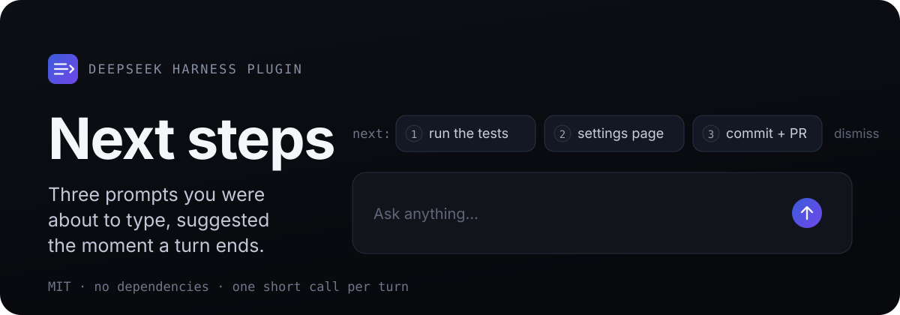
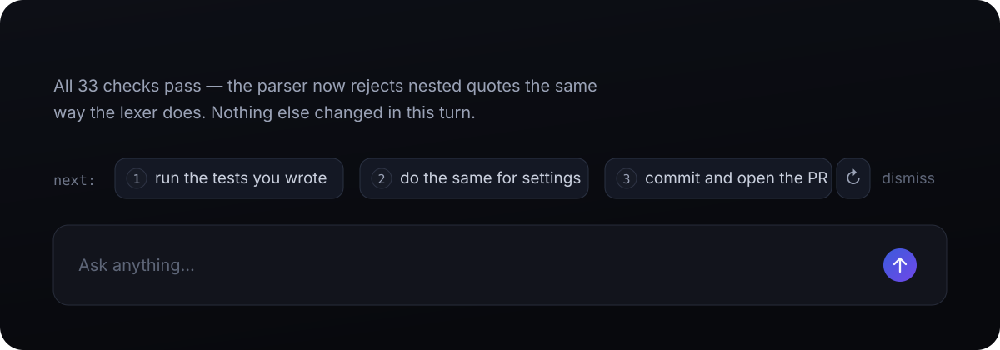
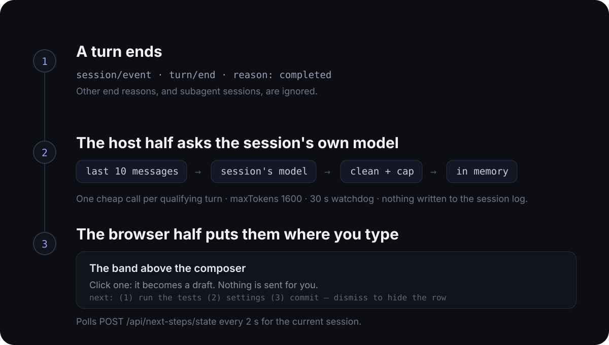

标题（发布时填在 Title 栏）：

DSH｜Next steps｜每轮回答结束后给出三条下一步提示

------------------------------------------------
正文（以下整段粘贴到讨论正文）：

> **非官方项目，由社区成员独立开发和维护。**

**项目地址：**
https://github.com/WURONZON/dsh-next-steps

**项目介绍：**
Next steps 是一个 DeepSeek Harness 插件。每轮回答结束，它读一遍最近的对话，用当前会话自己的模型猜你接下来最可能发什么，然后把最多三条带编号的提示摆到输入框上方——点一条会写进输入框变成草稿（改完自己按回车，插件从不替你发送），不满意可以原地重新生成，不需要就 dismiss。

- **不用再配一个 provider。** 建议跑在会话本来就在用的模型路由上，没有第二把 API key，也不会多出一份账单。
- **建议真的读过这段对话。** 模型看到最近十条人和模型的消息，以及（可选）本会话的技能清单，所以一条建议可以是改改就能发的 `/skill` 提示，并沿用你正在使用的语言。
- **成本可控。** 每个符合条件的轮次只花一次很短的模型调用，可用 `minAnswerChars` / `maxInputChars` 等配置收紧。

**截图：**

**与 DSH 的集成方式：**

以标准 DSH bundle 集成：`package.json` 声明 `dsh.bundle.patch`（指向 `cordis.patch.yml`）和 `dsh.client`，向 `@deepseek-ai/dsh-client-ui-conversation` 注入客户端代码，宿主半边与浏览器半边作为同一个 bundle 发布。

- **宿主半边（`index.js`）**：监听 `turn/end`（`completed`）事件，构建最近十条消息摘要，调用该会话记录的模型路由（依次回退到最新请求头、进程默认值），把返回的 JSON 清洗后按会话缓存在内存。
- **浏览器半边（`client.js`）**：在输入框上方注册建议条，每 2 秒轮询 `POST /api/next-steps/state` 拉取当前会话的建议，用宿主的主题 token 与 locale 服务渲染。
- **安装**：桌面应用走「设置 → 插件」安装 bundle；`dsh web` 一条命令 `dsh plugin --profile web add "$PWD/dsh-next-steps"`。

被中止、出错、被打断的轮次和子代理会话都会被忽略；插件不向会话日志追加任何内容，也从不提交任何提示词。
